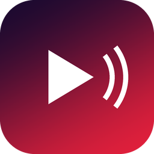
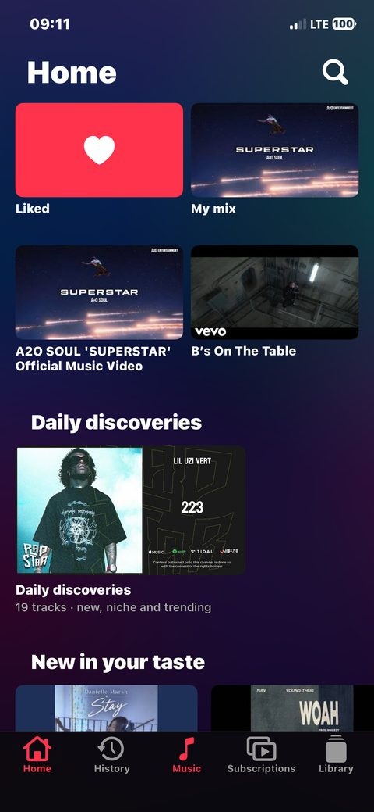
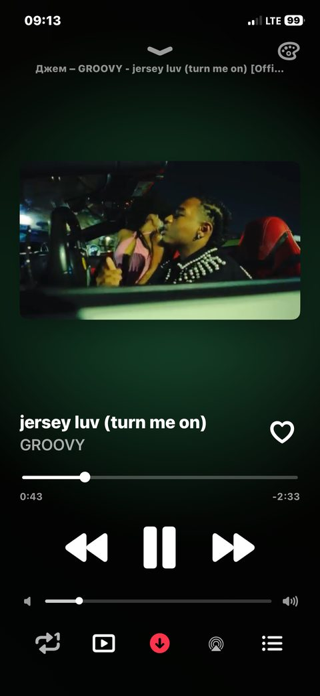
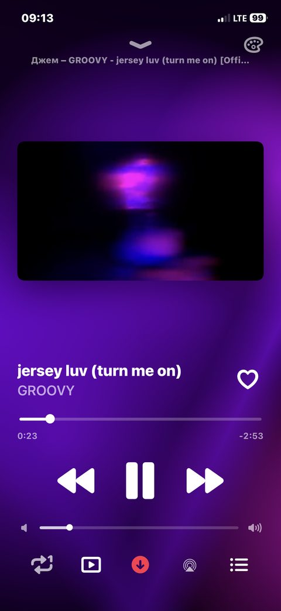
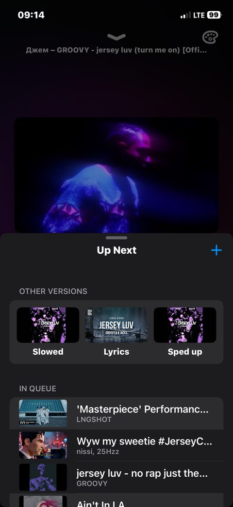
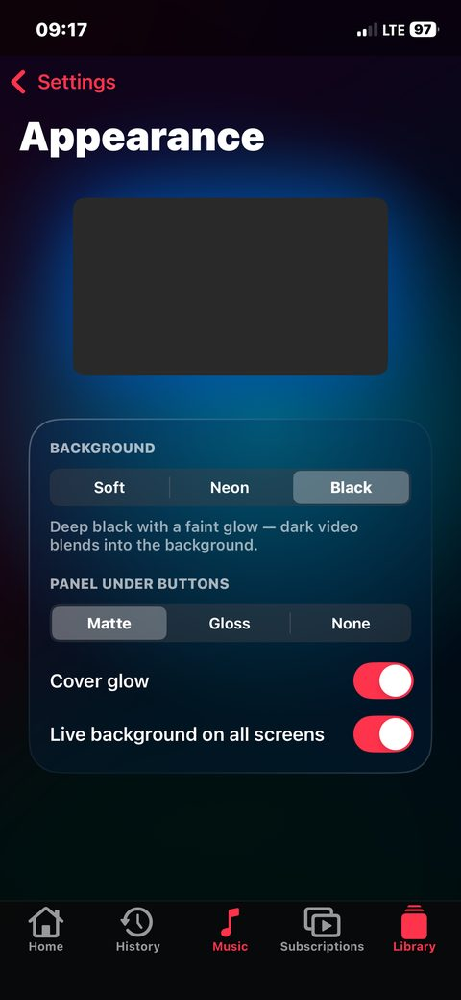
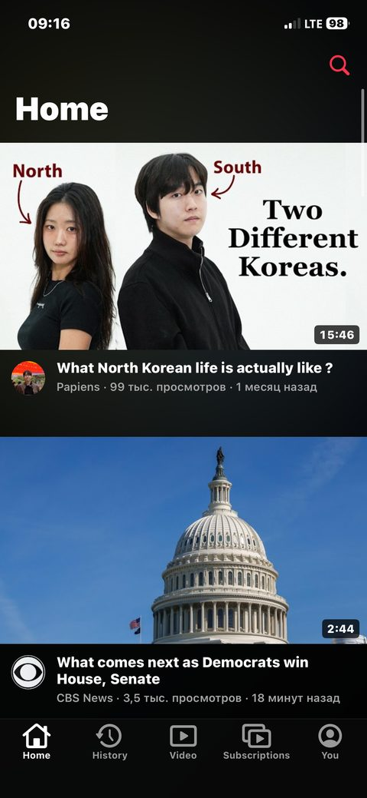

<h1 align="center">Fon</h1>

**English** · [Русский](#русский)

  
  
  

  
  
  

I'm not a programmer, just a regular user who wanted my own music player for YouTube. So I made one with AI ([Claude](https://claude.ai/code)). It's open source now — take it, change it, make your own.

What it does on iPhone and iPad: plays music in the background, has a music mode and a video mode, a live animated background and a player customizer. English and Russian.

I didn't remove YouTube ads — there are none in my country :)

**Install:** add `https://github.com/esasabiyatov-afk/fon/releases/latest/download/apps.json` to [SideStore](https://sidestore.io), or grab `Fon.ipa` from [Releases](../../releases).

**Your own version:** fork, enable Actions, change the name and bundle id in `project.yml` and `.github/workflows/build.yml`, push to `main`. You get your own SideStore source. No Mac needed.

Unofficial, not affiliated with Google or YouTube, use at your own risk. MIT. Ideas and questions — Issues. Want to help — [CONTRIBUTING.md](CONTRIBUTING.md).

---

## Русский

Я не программист, а обычный пользователь, которому захотелось свой музыкальный плеер для YouTube. Сделал его с ИИ ([Claude](https://claude.ai/code)). Теперь код открыт: берите, меняйте, делайте свои версии.

Что умеет на iPhone и iPad: играет музыку в фоне, есть режим музыки и режим видео, живой анимированный фон и настройщик плеера. Русский и английский.

Рекламу YouTube я не убирал — в моей стране её нет :)

**Установка:** добавьте `https://github.com/esasabiyatov-afk/fon/releases/latest/download/apps.json` в [SideStore](https://sidestore.io) или скачайте `Fon.ipa` из [Releases](../../releases).

**Своя версия:** сделайте Fork, включите Actions, поменяйте название и bundle id в `project.yml` и `.github/workflows/build.yml`, сделайте push в `main`. Получите свой источник для SideStore. Mac не нужен.

Неофициальный, не связан с Google и YouTube, на свой риск. MIT. Идеи и вопросы — в Issues. Хотите помочь — [CONTRIBUTING.md](CONTRIBUTING.md).
